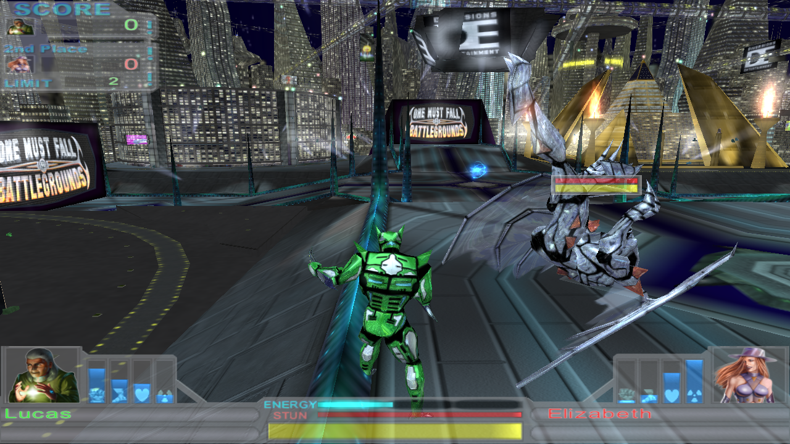

# openomf-battlegrounds



**openomf-battlegrounds** is an open-source reimplementation of the engine behind
*One Must Fall: Battlegrounds* (Diversions Entertainment, 2003), the 3D sequel to *One Must Fall: 2097*.
In the spirit of [OpenOMF](https://github.com/omf2097/openomf) and ScummVM, it runs the original
game's own data (the robots, pilots, arenas, menus, scripts, sound and music) on a new, native
engine, so the game can be played on modern machines.

> **Status: alpha.** Single-player tournaments, Practice and Training run end to end: the original
> menus, robot and pilot selection, every robot and arena, the computer opponents, the HUD, sound,
> music and replays. LAN and direct-IP play work for two players (Last Man Standing, one against
> one): Host Game serves the match on UDP port 2002 (Options > Network > Listener Port), and Join
> Game lists the sessions on your network or takes an address. Internet play through a lobby is not
> supported yet. Expect bugs and rough edges.
> [PLACEHOLDERS.md](PLACEHOLDERS.md) lists everything that is still missing or approximated.

The port follows the game's final official patch, **2.123**.

## Launcher (macOS and Windows)

From [Releases](https://github.com/kadima-tech/openomf-battlegrounds/releases):

- **macOS 13 or newer:** download the Apple silicon (`arm64`) or Intel (`x86_64`) ZIP,
  unzip it and open **`Battlegrounds.app`**.
- **Windows 10 or 11 (64-bit):** download the `windows-x64` ZIP, extract all files and
  run **`Battlegrounds\Battlegrounds.exe`**. No installer, administrator rights,
  Visual C++ runtime or Python installation are needed. Windows 11 on Arm runs it
  through x64 emulation.

Dev builds are marked **Pre-release**. Downloads include the compiled engine and
launcher; you still need your own game CD/ISO. See
[launcher/README.md](launcher/README.md#ci-builds-and-releases) for build triggers and
signing details.

From a source checkout, double-click **`launch.command`** (macOS) or **`launch.cmd`**
(Windows, see [Building on Windows](#building-on-windows)) to build and open the native
launcher. On first
run, choose your original English game CD/ISO; an inserted CD is detected
automatically. Confirm **Start setup** before installation (3 GB free space
required). The launcher extracts the game and applies its bundled cumulative
update offline, then starts the game. The update and setup tools ship inside the
app. Once a complete 2.123 installation is present, future launches skip setup.

The macOS source build needs Xcode's command-line tools, CMake and Python 3. The resulting
**`dist/Battlegrounds.app`** can be distributed without those build tools or
Homebrew dependencies. On Windows the result is the **`dist\Battlegrounds`** folder.
See [launcher/README.md](launcher/README.md) for packaging, storage locations and
validation. The manual build/install instructions below remain available for development.

## Launcher (Linux)

Download the `x86_64` or `aarch64` `.tar.gz` from
[Releases](https://github.com/kadima-tech/openomf-battlegrounds/releases), unpack it
anywhere and run **`Battlegrounds/Battlegrounds`**. It needs a desktop with GTK 3
and OpenGL 4.1 (Mesa or a vendor driver) on glibc 2.35 or newer: Ubuntu 22.04,
Debian 12, Fedora 36 or later, and their derivatives. X11 and Wayland both work.
The download includes the engine, setup tools and Python runtime; no packages are
installed. Run `Battlegrounds/Battlegrounds --create-desktop-entry` to add it to
your application menu.

Setup works as on macOS: choose or drop your ISO, or mount the game CD (it is
detected automatically), confirm **Start setup**, and the launcher extracts the
game, applies the bundled update offline and starts it. From a source checkout,
run **`./launch.sh`** to build and open the launcher; see
[launcher/README.md](launcher/README.md#linux) for the build packages.

## You need the game

You need your own copy of *One Must Fall: Battlegrounds*, either the original English
Windows CD or an ISO image of it. The launcher includes a cumulative 2.090 → 2.123
update; a complete game installation is not included.

## Building

openomf-battlegrounds builds on **macOS** (Apple silicon or Intel), **Linux** (x86_64 or aarch64;
Ubuntu, Debian and Fedora are tested) and **Windows 10/11** (x64, see
[below](#building-on-windows)). On macOS and Linux you need CMake 3.20 or newer, a C++20 compiler
and SDL2. On macOS, use Xcode's command-line tools and Homebrew:

```sh
brew install cmake sdl2 unshield
```

On Debian or Ubuntu (Fedora: `cmake gcc-c++ SDL2-devel mesa-libGL-devel zlib-devel unshield bsdtar python3`):

```sh
sudo apt install cmake g++ libsdl2-dev libgl-dev zlib1g-dev unshield libarchive-tools python3
```

Then build:

```sh
git clone https://github.com/kadima-tech/openomf-battlegrounds.git
cd openomf-battlegrounds
cmake -S engine -B engine/build
cmake --build engine/build -j
```

The Indeo video decoder, [openindeo](https://github.com/kadima-tech/openindeo), is fetched by CMake
automatically. Run `ctest --test-dir engine/build` to check that your game data parses.

The build also makes `openbg-editor`, a first version of the content editor for making new pilots,
tournaments, robot variants and arenas (including robots, arenas and props imported from glTF /
Blender / Mixamo, and glTF export of the game's meshes, arenas and robots) as an add-on `.DEObjects` file next to the
untouched game data ([DEVELOPING.md](DEVELOPING.md#the-content-editor),
[docs/EDITOR_SPEC.md](docs/EDITOR_SPEC.md)).

### Building on Windows

Windows builds use MinGW-w64 from [MSYS2](https://www.msys2.org). Double-click **`launch.cmd`** in
a checkout. It sets up whatever is missing, asking before each step:

1. Without MSYS2 in `C:\msys64`, it offers to install it with `winget`, the package manager in
   Windows 11 and current Windows 10. Windows then asks for administrator approval.
2. It offers to install any missing build packages (GCC, CMake, Ninja, Python, Git) with MSYS2's
   `pacman`, about 1 GB.

It then builds the standalone launcher (`dist\Battlegrounds`, with SDL2, zlib and unshield
fetched at pinned versions and linked in) and opens it. Later runs rebuild only when the sources
changed. Set `MSYS2_ROOT` if MSYS2 is installed elsewhere. To set things up by hand instead,
install MSYS2 and run this in its **MSYS2 UCRT64** shell (SDL2 and zlib are only needed for the
engine development build below):

```sh
pacman -S --needed git mingw-w64-ucrt-x86_64-gcc mingw-w64-ucrt-x86_64-cmake \
  mingw-w64-ucrt-x86_64-ninja mingw-w64-ucrt-x86_64-python \
  mingw-w64-ucrt-x86_64-SDL2 mingw-w64-ucrt-x86_64-zlib
```

For engine development, build in the UCRT64 shell as on macOS:

```sh
cmake -S engine -B engine/build -G Ninja
cmake --build engine/build
```

That development build uses MSYS2's SDL2 and zlib DLLs, so run its programs from the UCRT64 shell.
The game needs a graphics driver with OpenGL 4.1, which every Windows 10/11 driver for GPUs from
roughly 2012 onwards provides. Linux developers can cross-compile the Windows download with
`launcher/windows/build-windows.sh` after installing MinGW-w64 (`g++-mingw-w64-x86-64-posix` on
Debian and Ubuntu), CMake and Ninja.

## Reconstructing the historical patch chain

The launcher installs directly from your disc/ISO using its bundled cumulative update,
with no network access. The steps below are for developers reproducing the original
version trees for analysis; they are not needed to use the app.

**1. Unpack the disc.** Copy your ISO into `source/` and extract its installer (`bsdtar` is in
Debian/Ubuntu's `libarchive-tools` package):

```sh
mkdir -p source/iso
cp /path/to/Battlegrounds.iso source/
bsdtar -xf source/Battlegrounds.iso -C source/iso Setup
unshield -d source/extracted x source/iso/Setup/data1.cab
```

This gives you the disc version of the game (2.090) in `source/extracted/App_Executables`.

**2. Apply the official patches.** Put the official patch files in `source/patches/` under their
original names (see [PATCHES.md](PATCHES.md) for the list), then run:

```sh
pip3 install unicorn pefile
re/scripts/rtpatch_chain.sh /tmp/omfbg-patching
```

This applies each patch in turn to a copy of the disc files, inside an emulator (no patch program
runs natively), and writes the result to `source/patched/v2123`. You can also patch an installed
copy of the game on Windows and copy its `Data` and `Engine` folders into `source/patched/v2123`.

The `source/` folder is ignored by git, so your game files never end up in a commit.

## Playing

```sh
engine/build/openbg source/patched/v2123/Data
```

(On Windows: `engine\build\openbg.exe source\patched\v2123\Data`.) This starts the game at its main menu. Choose **Single Player** and pick a tournament, Practice or
Training.

**Fight controls:**

| Key | Action |
|---|---|
| Arrow keys | Walk (up/down) and turn (left/right) |
| A / S | Left / right punch |
| Z / X | Left / right kick |
| Space | Jump (add a direction to jump that way) |
| Left Shift or C | Duck and evade (add left/right to sidestep) |
| Esc | In-game menu |
| V | Replay controls (during a replay) |

To jump straight into a single fight against the computer:

```sh
engine/build/openbg-fight source/patched/v2123/Data Jaguar --opponent Katana --arena Desert
```

Robots: Jaguar, Katana, Gargoyle, Chronos, Mantis, Pyros, Warlord, Force. Arenas: Desert, BladePit,
Canyon, City, FirePit, Iceberg, PowerPlant, SpaceStation, Volcano.

## How it works

The original game runs on Diversions Entertainment's "DE" engine: a set of module DLLs plus a large
amount of game logic written in the engine's own scripting language and shipped as compiled
bytecode inside the data files. openomf-battlegrounds reimplements the engine (the data formats,
the script virtual machine and its native functions, scenes, physics, AI, rendering, sound and
music) and runs the game's own scripts on top of it. The behaviour is reverse engineered from the
game's modules; [re/FINDINGS.md](re/FINDINGS.md) records what each part does and where it was
read from. The copy-protected game executable is never decrypted.

## Contributing

Contributions and bug reports are welcome. Start with [CONTRIBUTING.md](CONTRIBUTING.md)
and our [Code of Conduct](CODE_OF_CONDUCT.md). [DEVELOPING.md](DEVELOPING.md) describes
the code, tools and debugging switches; [PLACEHOLDERS.md](PLACEHOLDERS.md) lists open
work; [PATCHES.md](PATCHES.md) documents the official patches; [docs/ROADMAP.md](docs/ROADMAP.md) lists planned work. Report vulnerabilities
using [SECURITY.md](SECURITY.md).

## License

This project's original code and documentation are available under the
[MIT license](LICENSE), including its warranty disclaimer and limitation of liability.
The downloads include this license and the dependency notices in
`Battlegrounds.app/Contents/Resources/licenses/` (macOS), `Battlegrounds\resources\licenses\`
(Windows) or `Battlegrounds/resources/licenses/` (Linux).

Third-party components retain their own terms; see
[THIRD_PARTY_NOTICES.md](THIRD_PARTY_NOTICES.md). The original game and its update
data, including the bundled cumulative update, are not covered by this project's
MIT license. You still need your own copy of the game.

## Credits

*One Must Fall: Battlegrounds* was developed by Diversions Entertainment and belongs to its rights
holders. This project is not affiliated with or endorsed by them and does not include
a complete copy of the game.

Third-party code included in this repository keeps its own licence: GothicKit's
[dmusic](https://github.com/GothicKit/dmusic) (MIT, vendored in `engine/third_party/dmusic`) and a C
port of Microsoft's DirectMusic software synthesizer sample (MIT). See
[engine/third_party/dmusic/VENDORED.md](engine/third_party/dmusic/VENDORED.md).
