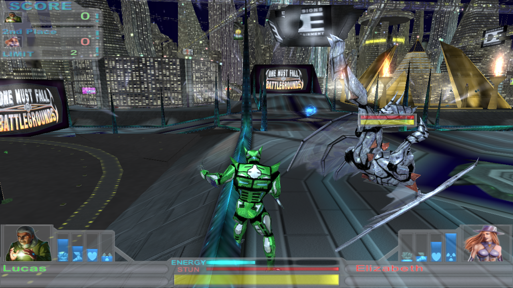

# openomf-battlegrounds



**openomf-battlegrounds** is an open-source reimplementation of the engine behind
*One Must Fall: Battlegrounds* (Diversions Entertainment, 2003), the 3D sequel to *One Must Fall: 2097*.
In the spirit of [OpenOMF](https://github.com/omf2097/openomf) and ScummVM, it runs the original
game's own data (the robots, pilots, arenas, menus, scripts, sound and music) on a new, native
engine, so the game can be played on modern machines.

> **Status: alpha.** Single-player tournaments, Practice and Training run end to end: the original
> menus, robot and pilot selection, every robot and arena, the computer opponents, the HUD, sound,
> music and replays. Expect bugs and rough edges. Online and LAN play are not supported yet.
> [PLACEHOLDERS.md](PLACEHOLDERS.md) lists everything that is still missing or approximated.

The port follows the game's final official patch, **2.123**.

## Launcher (macOS)

Download the Apple silicon (`arm64`) or Intel (`x86_64`) ZIP from
[Releases](https://github.com/kadima-tech/openomf-battlegrounds/releases), unzip it,
and open **`Battlegrounds.app`** on macOS 13 or newer. Dev builds are marked
**Pre-release**. Downloads include the compiled engine and launcher; you still
need your own game CD/ISO. See [launcher/README.md](launcher/README.md#ci-builds-and-releases)
for build triggers and signing details.

Double-click **`launch.command`** to build and open the native launcher. On first
run, choose your original English game CD/ISO; an inserted CD is detected
automatically. The launcher extracts the game and applies its bundled cumulative
update offline, then starts the game. The update and setup tools ship inside the
app. Once a complete 2.123 installation is present, future launches skip setup.

The source build needs Xcode's command-line tools, CMake and Python 3. The resulting
**`dist/Battlegrounds.app`** can be distributed without those build tools or
Homebrew dependencies. See [launcher/README.md](launcher/README.md) for packaging,
storage locations and validation. The manual build/install instructions below
remain available for development.

## You need the game

You need your own copy of *One Must Fall: Battlegrounds*, either the original English
Windows CD or an ISO image of it. The launcher includes a cumulative 2.090 → 2.123
update; a complete game installation is not included.

## Building

openomf-battlegrounds currently builds on **macOS** (Apple silicon or Intel). You need CMake 3.20 or
newer, a C++20 compiler (Xcode's command-line tools), and a few packages from Homebrew:

```sh
brew install cmake sdl2 unshield
```

Then build:

```sh
git clone https://github.com/kadima-tech/openomf-battlegrounds.git
cd openomf-battlegrounds
cmake -S engine -B engine/build
cmake --build engine/build -j
```

The Indeo video decoder, [openindeo](https://github.com/kadima-tech/openindeo), is fetched by CMake
automatically. Run `ctest --test-dir engine/build` to check that your game data parses.

## Reconstructing the historical patch chain

The launcher installs directly from your disc/ISO using its bundled cumulative update,
with no network access. The steps below are for developers reproducing the original
version trees for analysis; they are not needed to use the app.

**1. Unpack the disc.** Copy your ISO into `source/` and extract its installer:

```sh
mkdir -p source/iso
cp /path/to/Battlegrounds.iso source/
bsdtar -xf source/Battlegrounds.iso -C source/iso Setup
unshield -d source/extracted x source/iso/Setup/data1.cab
```

This gives you the disc version of the game (2.090) in `source/extracted/App_Executables`.

**2. Apply the official patches.** Put the official patch files in `source/patches/` under their
original names (see [PATCHES.md](PATCHES.md) for the list), then run:

```sh
pip3 install unicorn pefile
re/scripts/rtpatch_chain.sh /tmp/omfbg-patching
```

This applies each patch in turn to a copy of the disc files, inside an emulator (no patch program
runs natively), and writes the result to `source/patched/v2123`. You can also patch an installed
copy of the game on Windows and copy its `Data` and `Engine` folders into `source/patched/v2123`.

The `source/` folder is ignored by git, so your game files never end up in a commit.

## Playing

```sh
engine/build/openbg source/patched/v2123/Data
```

This starts the game at its main menu. Choose **Single Player** and pick a tournament, Practice or
Training.

**Fight controls:**

| Key | Action |
|---|---|
| Arrow keys | Walk (up/down) and turn (left/right) |
| A / S | Left / right punch |
| Z / X | Left / right kick |
| Space | Jump (add a direction to jump that way) |
| Left Shift or C | Duck and evade (add left/right to sidestep) |
| Esc | In-game menu |
| V | Replay controls (during a replay) |

To jump straight into a single fight against the computer:

```sh
engine/build/openbg-fight source/patched/v2123/Data Jaguar --opponent Katana --arena Desert
```

Robots: Jaguar, Katana, Gargoyle, Chronos, Mantis, Pyros, Warlord, Force. Arenas: Desert, BladePit,
Canyon, City, FirePit, Iceberg, PowerPlant, SpaceStation, Volcano.

## How it works

The original game runs on Diversions Entertainment's "DE" engine: a set of module DLLs plus a large
amount of game logic written in the engine's own scripting language and shipped as compiled
bytecode inside the data files. openomf-battlegrounds reimplements the engine (the data formats,
the script virtual machine and its native functions, scenes, physics, AI, rendering, sound and
music) and runs the game's own scripts on top of it. The behaviour is reverse engineered from the
game's modules; [re/FINDINGS.md](re/FINDINGS.md) records what each part does and where it was
read from. The copy-protected game executable is never decrypted.

## Contributing

Contributions and bug reports are welcome. Start with [CONTRIBUTING.md](CONTRIBUTING.md)
and our [Code of Conduct](CODE_OF_CONDUCT.md). [DEVELOPING.md](DEVELOPING.md) describes
the code, tools and debugging switches; [PLACEHOLDERS.md](PLACEHOLDERS.md) lists open
work; [PATCHES.md](PATCHES.md) documents the official patches. Report vulnerabilities
using [SECURITY.md](SECURITY.md).

## License

This project's original code and documentation are available under the
[MIT license](LICENSE), including its warranty disclaimer and limitation of liability.
The macOS downloads include this license and the dependency notices in
`Battlegrounds.app/Contents/Resources/licenses/`.

Third-party components retain their own terms; see
[THIRD_PARTY_NOTICES.md](THIRD_PARTY_NOTICES.md). The original game and its update
data, including the bundled cumulative update, are not covered by this project's
MIT license. You still need your own copy of the game.

## Credits

*One Must Fall: Battlegrounds* was developed by Diversions Entertainment and belongs to its rights
holders. This project is not affiliated with or endorsed by them and does not include
a complete copy of the game.

Third-party code included in this repository keeps its own licence: GothicKit's
[dmusic](https://github.com/GothicKit/dmusic) (MIT, vendored in `engine/third_party/dmusic`) and a C
port of Microsoft's DirectMusic software synthesizer sample (MIT). See
[engine/third_party/dmusic/VENDORED.md](engine/third_party/dmusic/VENDORED.md).
